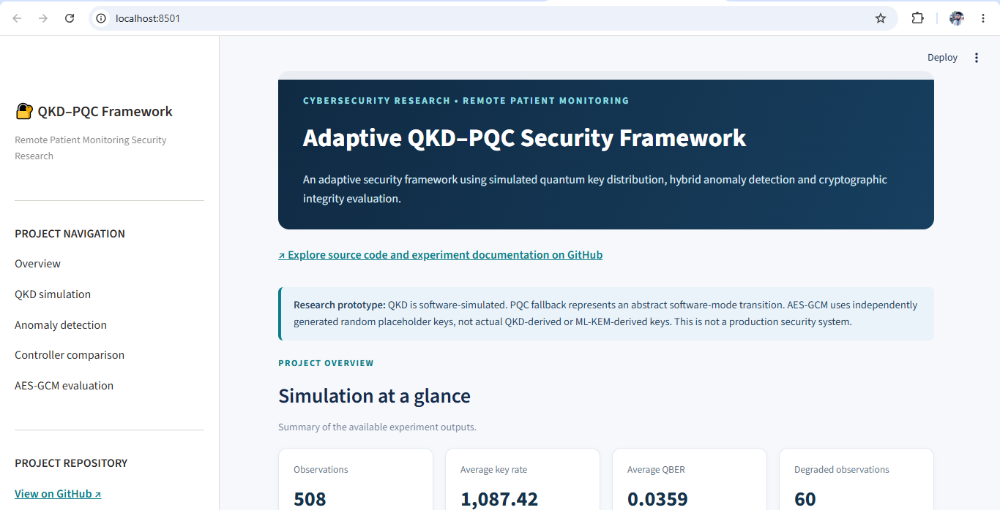
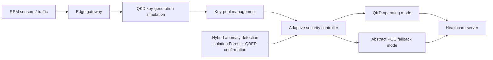

# Adaptive QKD--PQC Security Framework for Remote Patient Monitoring

**Research title:** An Adaptive QKD--PQC Security Framework for Remote
Patient Monitoring Using Hybrid Anomaly Detection and Key-Pool
Management

**Supervisor:** Dr. U. Hariharan\
**Team IDs:** 23BAI70692, 23BAI70700\
**Project status:** Implementation and simulation-based experimental
evaluation completed

[](https://www.python.org/)
[](https://streamlit.io/)
[](#security-model-and-research-limitations)

> **Research prototype --- not a production security system.** QKD key
> generation is simulated at the system level. PQC fallback is an
> abstract software-mode transition. The AES-GCM experiment uses
> independently generated random placeholder keys, not keys derived from
> QKD or ML-KEM. The framework has not been validated on physical
> quantum hardware, a live healthcare network, or clinical workflows.

## Dashboard preview



The Streamlit dashboard presents the available QKD simulation,
anomaly-detection, controller-comparison, and AES-GCM experiment
outputs.

**Live dashboard:** Coming soon --- deployment on Streamlit Community
Cloud is not yet confirmed.

## 1. Project overview

This research investigates the challenge of balancing simulated Quantum
Key Distribution (QKD) secret-key generation with continuous
cryptographic key demand in Remote Patient Monitoring (RPM)
environments.

The project develops a system-level adaptive security framework that
models RPM traffic, QKD key generation, key-pool management, and
adaptive switching between QKD mode and an abstract Post-Quantum
Cryptography (PQC) fallback mode.

A hybrid anomaly-detection approach combining Isolation Forest and
QBER-based confirmation is implemented to investigate whether
machine-learning-assisted detection can improve adaptive security
decisions under simulated channel degradation.

The framework is evaluated through synthetic RPM traffic, simulated
channel scenarios, controller comparisons, multi-seed experiments, and
separate AES-256-GCM integrity validation.

### Research motivation

RPM systems can generate recurring data transmissions while the
availability of QKD-generated secret key material may vary with
simulated channel conditions. The project studies this system-level
mismatch between key availability and key demand, including key-pool
depletion and fallback timing under configured degradation scenarios.

## 2. Research objectives

1.  Model synthetic and real-data-derived RPM traffic.
2.  Simulate QKD key generation under normal and degraded channel
    conditions.
3.  Investigate key-pool consumption, replenishment, and depletion.
4.  Implement adaptive switching between QKD and an abstract PQC
    fallback mode.
5.  Evaluate hybrid anomaly detection using Isolation Forest and QBER
    confirmation.
6.  Evaluate AES-256-GCM encryption, decryption, and integrity
    validation using simulated RPM traffic and independent placeholder
    keys.
7.  Examine system performance, security trade-offs, and implementation
    limitations.

## 3. Proposed system architecture



The framework also includes a hybrid anomaly-detection component that
analyses simulated channel behaviour and supports adaptive controller
decisions.

QKD and PQC rely on different security assumptions. The fallback
mechanism therefore represents a change in the security model rather
than an equivalent replacement for QKD.

## 4. Interactive research dashboard

### Run locally

From the repository root, install the pinned dependencies and start
Streamlit:

``` powershell
python -m pip install -r requirements.txt
python -m streamlit run app.py
```

Then open the local URL printed by Streamlit (normally
`http://localhost:8501`).

### Dashboard sections

-   **Overview:** summary of available simulation outputs.
-   **QKD simulation:** time-series view of simulated key-generation
    rate, QBER, and channel state.
-   **Anomaly detection:** available detector metrics and
    confusion-matrix view.
-   **Controller comparison:** comparison of the baseline and
    hybrid-controller outputs.
-   **AES-GCM evaluation:** summary of the separate encryption,
    decryption, and integrity-validation experiment.

The dashboard reads the selected, committed files in `dashboard_data/`.
It does not require the full raw PhysioNet dataset to display these
precomputed summaries.

## 5. Implemented components

  --------------------------------------------------------------------------------------
  Component                           Implementation
  ----------------------------------- --------------------------------------------------
  RPM traffic simulation              `rpm_simulator.py`

  QKD key-generation simulation       `qkd_simulator.py`

  Key-pool management                 `key_pool.py`

  Adaptive security controller        `adaptive_controller_v5.py`

  Hybrid anomaly detection            `anomaly_detection_v5_hybrid_confirmation.py`

  AES-GCM integration and validation  `aes_gcm_integration_v5_roundtrip.py`

  PhysioNet preprocessing             `process_physionet.py`

  Real-data-derived RPM traffic       `real_rpm_generator.py`
  generation

  Multi-seed robustness experiment    `multi_seed_robustness_v5_hybrid_experiment3.py`

  Late-fallback audit                 `late_fallback_audit_experiment3.py`

  Statistical analysis                `analyze_experiment3_statistics.py`

  Regression tests                    `tests/test_critical_fixes.py`

  Interactive dashboard               `app.py`
  --------------------------------------------------------------------------------------

These components implement simulation and experimental evaluation
workflows. Their presence does not establish physical QKD operation,
actual PQC key exchange, or clinical deployment.

## 6. Repository structure

``` text
QKD-RPM-GitHub/
├── dashboard_data/
│   ├── aes_gcm_summary.json
│   ├── isolation_forest_v5_metrics.csv
│   ├── qkd_generation_508s_v3.csv
│   └── v5_vs_v5_if_comparison.csv
├── docs/
│   ├── images/
│   │   └── dashboard-preview.png
│   ├── architecture.md
│   ├── critical-fixes.md
│   ├── experimental-plan.md
│   └── research-gap.md
├── results/
│   ├── .gitkeep
│   └── reproducibility/
│       ├── critical_fixes_test_report.txt
│       ├── experiment3_late_fallback_overall_summary.csv
│       ├── experiment3_paired_statistical_tests.csv
│       └── multi_seed_overall_summary.csv
├── src/
│   ├── adaptive_controller_v5.py
│   ├── aes_gcm_integration_v5_roundtrip.py
│   ├── analyze_experiment3_statistics.py
│   ├── anomaly_detection_v5_hybrid_confirmation.py
│   ├── key_pool.py
│   ├── late_fallback_audit_experiment3.py
│   ├── multi_seed_robustness_v5_hybrid.py
│   ├── multi_seed_robustness_v5_hybrid_experiment3.py
│   ├── process_physionet.py
│   ├── qkd_simulator.py
│   ├── real_rpm_generator.py
│   └── rpm_simulator.py
├── tests/
│   └── test_critical_fixes.py
├── app.py
├── .gitignore
├── README.md
└── requirements.txt
```

Dataset files, virtual environments, temporary files, and most generated
experiment outputs are excluded from Git. Selected reproducibility
evidence is maintained under `results/reproducibility/`. The four
selected dashboard input files are stored separately under
`dashboard_data/` so the dashboard can render from a fresh repository
checkout without committing the raw dataset or the full
generated-results directory.

## 7. Software requirements

-   Python
-   NumPy
-   Pandas
-   Matplotlib
-   Scikit-learn
-   Cryptography
-   Streamlit
-   SciPy (required by the statistical analysis script; installed
    separately)

Install the dependencies listed in `requirements.txt`:

``` powershell
python -m pip install -r requirements.txt
```

Install SciPy separately for Experiment 3 statistical analysis:

``` powershell
python -m pip install scipy
```

The primary dependencies are pinned in `requirements.txt`. SciPy is not
currently pinned there. Record the installed package versions when
reproducing the statistical analysis.

## 8. PhysioNet dataset setup

The real-data-derived RPM traffic-generation workflow uses the **Pulse
Transit Time PPG Dataset v1.1.0**.

-   Official dataset page:
    https://physionet.org/content/pulse-transit-time-ppg/1.1.0/
-   DOI: https://doi.org/10.13026/jpan-6n92

Download the required source files:

-   `s1_sit.csv`
-   `subjects_info.csv`

Place them in:

``` text
data/physionet_ptt/csv/
```

Run preprocessing from the repository root:

``` powershell
python .\src\process_physionet.py
python .\src\real_rpm_generator.py
```

Generated files are stored in:

``` text
data/physionet_ptt/processed/
```

These include:

-   `s1_sit_processed.csv`
-   `s1_sit_ecg_heart_rate.csv`
-   `real_rpm_traffic.csv`

The generated RPM traffic file is an input to the AES-GCM integration
experiment.

Dataset files are excluded from Git. Obtain the dataset directly from
PhysioNet and follow its current licensing, attribution, and citation
requirements.

## 9. Experiment execution

Run commands from the repository root.

### 9.1 Install dependencies

``` powershell
python -m pip install -r requirements.txt
python -m pip install scipy
```

### 9.2 Generate synthetic RPM traffic

``` powershell
python .\src\rpm_simulator.py
```

Output: `data/synthetic_rpm/rpm_traffic.csv`

### 9.3 Generate QKD simulation data

Generate the default V2 dataset for the standalone key-pool experiment:

``` powershell
python .\src\qkd_simulator.py
```

Generate the V3-named dataset for the adaptive controller and hybrid
anomaly detection:

``` powershell
python .\src\qkd_simulator.py --output results/qkd_generation_508s_v3.csv
```

**Version clarification:** Both output files are generated using the
same QKD Simulator V2 implementation, simulation parameters, and random
seed. The V3 filename is retained for compatibility with the adaptive
controller and hybrid anomaly-detection scripts. It does not represent a
separate simulator version or a different QKD simulation algorithm.

Outputs:

-   `results/qkd_generation_508s_v2.csv`
-   `results/qkd_generation_508s_v3.csv`

### 9.4 Run standalone key-pool experiment

``` powershell
python .\src\key_pool.py --rpm data/synthetic_rpm/rpm_traffic.csv --qkd results/qkd_generation_508s_v2.csv
```

Outputs:

-   `results/key_pool_timeseries.csv`
-   `results/key_pool_summary.csv`

### 9.5 Run adaptive controller

``` powershell
python .\src\adaptive_controller_v5.py
```

The controller reads `results/qkd_generation_508s_v3.csv`. Its default
output prefix is `results/adaptive_508s_v5`.

### 9.6 Run hybrid anomaly detection

``` powershell
python .\src\anomaly_detection_v5_hybrid_confirmation.py
```

The experiment compares the original V5 controller against the V5
controller with Isolation Forest-based anomaly confirmation. Outputs are
saved in `results/anomaly_detection_v5_hybrid_confirmation/`.

### 9.7 Run Experiment 3: multi-seed robustness evaluation

The Experiment 3 workflow compares the V5 baseline controller with the
hybrid Isolation Forest controller under multiple simulated channel
scenarios.

The experiment uses:

-   10 seed bases, numbered 1001--1010.
-   Five simulated channel scenarios: baseline, short, long, multiple,
    and gradual degradation.
-   50 generated scenario traces.
-   100 controller executions, using paired inputs for the two
    controllers.
-   A 508-second simulated experiment duration.

Run:

``` powershell
python .\src\multi_seed_robustness_v5_hybrid_experiment3.py
```

The experiment generates detailed results used by the subsequent audit
and statistical-analysis scripts.

### 9.8 Run the late-fallback audit

After the multi-seed experiment has generated its detailed results, run:

``` powershell
python .\src\late_fallback_audit_experiment3.py
```

This audit evaluates fallback timing and degradation-interval detection,
including late fallback events, missed degradation intervals, undetected
degradation intervals, and genuine and other false fallback events.

### 9.9 Run paired statistical analysis

After the multi-seed experiment has generated its detailed and paired
comparison CSV files, run:

``` powershell
python .\src\analyze_experiment3_statistics.py
```

This analysis uses SciPy to calculate paired statistical comparisons,
including paired t-tests, Wilcoxon signed-rank tests, confidence
intervals, and Holm-adjusted p-values.

The statistical analysis uses 10 seed-level paired observations for the
overall comparison. Scenario-wise results are also reported.

Run the scripts in this order: multi-seed experiment, late-fallback
audit, and statistical analysis. The audit and statistical-analysis
scripts require the corresponding upstream experiment outputs.

### 9.10 Prepare PhysioNet-based RPM traffic

Download the required PhysioNet CSV files as described in the dataset
setup section, then run:

``` powershell
python .\src\process_physionet.py
python .\src\real_rpm_generator.py
```

The generated RPM traffic file is
`data/physionet_ptt/processed/real_rpm_traffic.csv`.

### 9.11 Run AES-256-GCM integration

After generating the PhysioNet-based RPM traffic and adaptive-controller
output, run:

``` powershell
python .\src\aes_gcm_integration_v5_roundtrip.py
```

Inputs:

-   `data/physionet_ptt/processed/real_rpm_traffic.csv`
-   `results/adaptive_508s_v5_timeseries.csv`

Outputs are saved in `results/aes_gcm/`.

**Important:** AES-GCM uses independent random placeholder keys. These
keys are not derived from the simulated QKD key pool or from an actual
PQC key exchange. This experiment validates encryption, decryption, and
integrity handling separately from the adaptive controller's
key-generation workflow.

## 10. Experimental results and reproducibility evidence

Selected experimental evidence is committed to
`results/reproducibility/`. The committed files include:

-   `critical_fixes_test_report.txt`
-   `experiment3_late_fallback_overall_summary.csv`
-   `experiment3_paired_statistical_tests.csv`
-   `multi_seed_overall_summary.csv`

### 10.1 Regression test results

The recorded regression-test report documents:

-   8 regression tests passed.
-   Adaptive-controller execution completed.
-   Hybrid anomaly-detection execution completed.
-   AES-GCM integration and integrity checks completed.

The recorded AES-GCM validation covered 2,040 packets. All 2,040 packets
passed the reported encryption, verification, and round-trip checks. The
recorded tests also detected AAD tampering, tag tampering, nonce
modification, and use of an incorrect key.

These are results from the recorded software test environment, not
evidence of clinical or physical quantum-network validation.

### 10.2 Multi-seed robustness results

The recorded Experiment 3 summary is:

  Metric                                 Hybrid IF   V5 Baseline
  ------------------------------------ ----------- -------------
  Scenario runs                                 50            50
  Total false fallbacks                          4             5
  Total missed degradation intervals             0             1
  IF-triggered fallbacks                        30             0
  Mean PQC-mode duration                   91.74 s       90.16 s
  Mean QKD-mode duration                  416.26 s      417.84 s
  Key accounting valid                         Yes           Yes

The 50 scenario runs per controller represent 10 seed bases evaluated
across five scenarios. They should not be interpreted as 50 independent
seed replications.

### 10.3 Late-fallback audit results

The recorded late-fallback audit summary is:

  Metric                            Hybrid IF   V5 Baseline
  ------------------------------- ----------- -------------
  Fallback count                           64            64
  Original false fallback count             4             5
  Late fallback count                       0             1
  Genuine false fallback count              4             4
  Missed degradation intervals              0             1
  Late-detected intervals                   0             1
  Undetected intervals                      0             0

Under the tested simulated scenarios, the hybrid controller recorded no
late fallbacks or missed degradation intervals, while the baseline
recorded one of each.

These observations are specific to the implemented simulation
configurations and should not be generalized to real-world QKD networks
or cyberattack detection.

### 10.4 Statistical analysis

The overall seed-level paired statistical analysis uses 10 paired
observations.

For the mean PQC-mode duration difference (Hybrid IF minus V5 baseline):

-   Mean difference: approximately +1.58 seconds.
-   95% confidence interval: approximately \[0.96, 2.20\] seconds.
-   Holm-adjusted paired t-test p-value: approximately 0.00487.
-   Holm-adjusted Wilcoxon p-value: 0.140625.

For mean detected fallback delay:

-   Mean difference: approximately −1.145 seconds.
-   95% confidence interval: approximately \[−1.561, −0.729\] seconds.
-   Holm-adjusted paired t-test p-value: approximately 0.00292.
-   Holm-adjusted Wilcoxon p-value: 0.140625.

The adjusted parametric and non-parametric tests do not lead to the same
significance conclusion. Therefore, the statistical evidence should be
interpreted cautiously rather than described as uniformly significant.

The complete paired statistical results, including scenario-wise
comparisons, are available in
`results/reproducibility/experiment3_paired_statistical_tests.csv`.

### 10.5 Dashboard data snapshot

The dashboard uses selected output files copied into `dashboard_data/`:

-   `qkd_generation_508s_v3.csv`
-   `isolation_forest_v5_metrics.csv`
-   `v5_vs_v5_if_comparison.csv`
-   `aes_gcm_summary.json`

These are dashboard inputs/snapshots, not a replacement for the full
experiment outputs. Re-run the relevant experiments and refresh these
files if you want the dashboard to represent a newer run. The dashboard
only displays what is present in these files.

## 11. Reproducibility notes

-   Run commands from the repository root.
-   Generate required upstream CSV files before running dependent
    experiments.
-   The standalone key-pool experiment and adaptive controller are
    separate experiments.
-   The AES-GCM integration uses the baseline adaptive-controller
    output, not the hybrid-controller output.
-   Experiment 3 requires the multi-seed experiment outputs before the
    audit and statistical analysis can run.
-   SciPy is required for the statistical-analysis script but is not
    currently pinned in `requirements.txt`.
-   Most generated experiment outputs are excluded from Git. Selected
    summary and test-evidence files are committed under
    `results/reproducibility/`.
-   The recorded test report documents the package versions used in that
    validation environment. They are not necessarily identical to the
    versions currently pinned in `requirements.txt`.
-   For strict reproduction, use the same scripts, input data,
    configuration, seed values, and compatible package versions.
-   A committed summary file is evidence of a recorded experiment; it
    does not independently guarantee that every experiment can be
    reproduced from a fresh clone without the required input datasets
    and generated intermediate files.

## 12. Security model and research limitations

The following distinctions are important when interpreting the
implementation:

-   **QKD:** Key generation is simulated at the system level. No
    physical quantum communication hardware, photon transmission, or
    experimental BB84 implementation is used.
-   **PQC:** The fallback mechanism is an abstraction. Actual ML-KEM key
    encapsulation, decapsulation, and key exchange are not implemented.
-   **Anomaly detection:** Isolation Forest is evaluated against
    simulated channel degradation. This is not proof of detection of
    real cyberattacks.
-   **AES-GCM:** AES-256-GCM encryption and decryption are implemented
    for a separate integration experiment. Independent random
    placeholder keys are used; they are not actual QKD-derived or
    ML-KEM-derived keys.
-   **RPM data:** PhysioNet-derived traffic is used for simulation. It
    should not be interpreted as clinical validation of the proposed
    framework.
-   **Experimental scenarios:** Multi-seed robustness and late-fallback
    results are based on configured synthetic channel scenarios, not
    physical network measurements.
-   **Statistical evidence:** The overall comparison uses 10 seed-level
    paired observations. The parametric and non-parametric adjusted
    tests differ in their conclusions, so results require cautious
    interpretation.
-   **Performance:** Experimental metrics describe the implemented
    simulation and software test environment. They must not be presented
    as physical measurements or clinical outcomes.

## 13. Research integrity

This project is a system-level adaptive security framework, not a new
QKD protocol or a production-ready healthcare security implementation.

All experimental assumptions, software versions, configurations, and
limitations should be documented. Simulated results must not be
presented as physical measurements, real quantum-communication results,
actual PQC key-exchange results, or clinical outcomes.

References and dataset attribution should be verified against their
original sources before publication.
